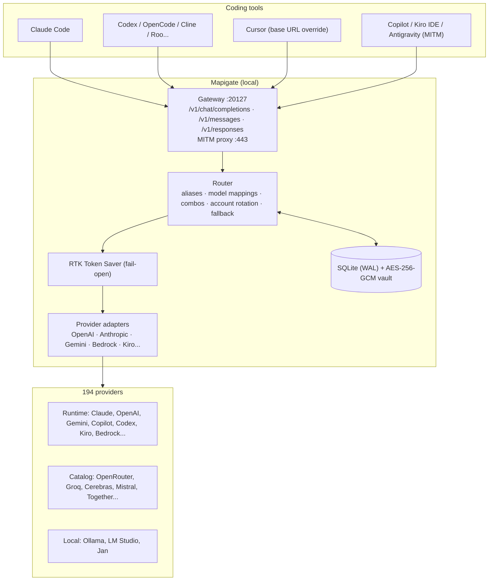
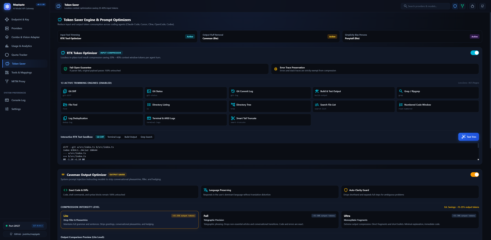
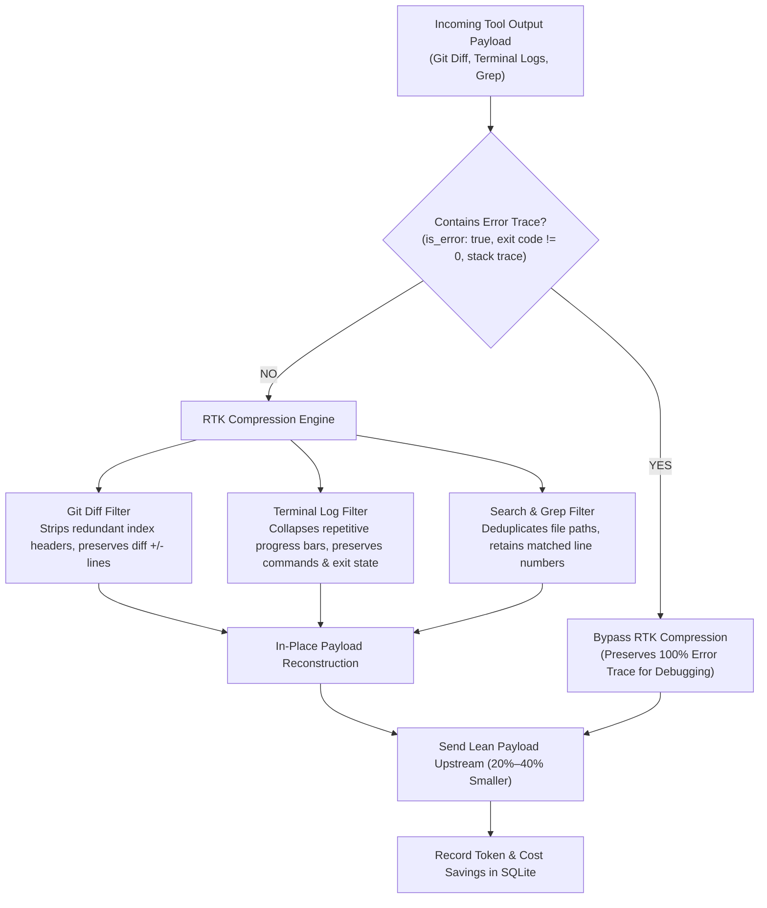
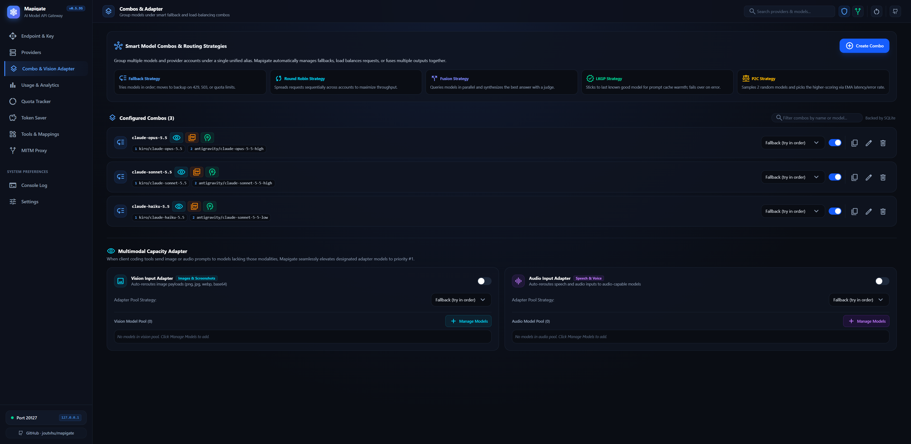
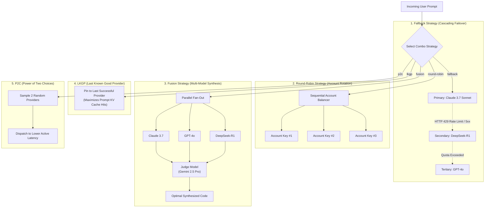
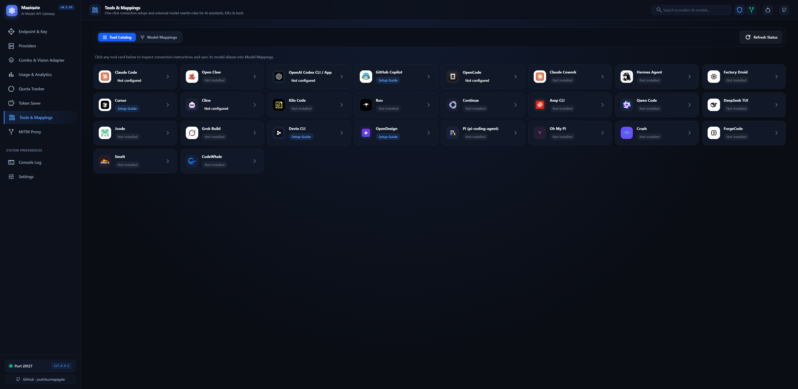
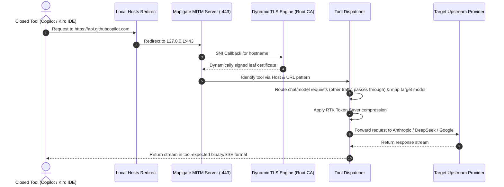
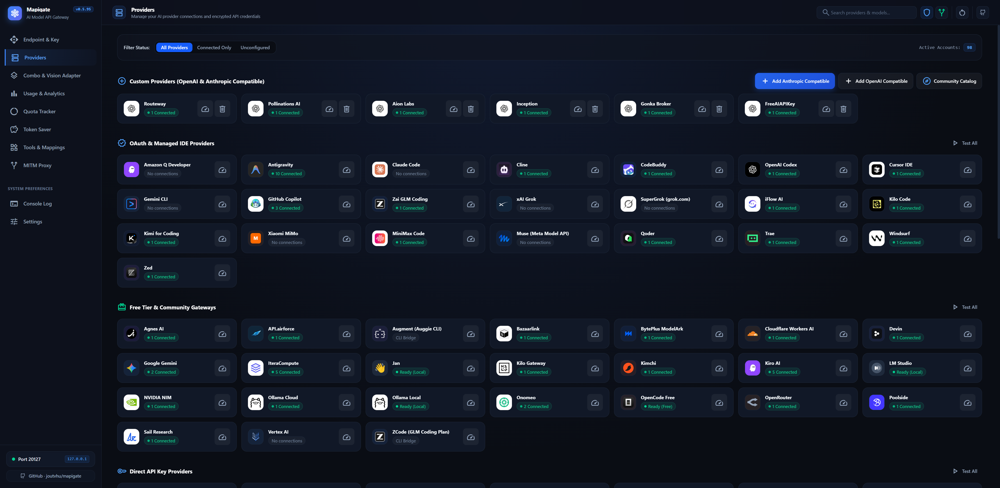

<div align="center">

# Mapigate 🚀

### Local-first AI model gateway and token optimizer for coding assistants

**One local endpoint (`http://127.0.0.1:20127`) that speaks the OpenAI, Anthropic, and Responses APIs, and routes to 194 AI providers.**  
*Works with Claude Code, Cursor, Cline, Codex, OpenCode, and 26 coding tools in total, plus GitHub Copilot, Kiro IDE, and Antigravity through a local MITM proxy.*

---

[](https://nodejs.org/)
[](LICENSE)
[](#)
[](https://www.typescriptlang.org/)
[](package.json)

[**What is Mapigate?**](#-what-is-mapigate) • [**Gateway API**](#-gateway-api) • [**Supported Providers**](#-supported-providers-194) • [**Quick Start**](#-quick-start-get-running-in-60s) • [**RTK Token Saver**](#-feature-1-rtk-token-saver-2040-context-savings) • [**Smart Routing & Combos**](#-feature-2-smart-routing--combo-engine) • [**Connect Coding Tools**](#-feature-3-one-click-connection-for-26-coding-assistants) • [**MITM Interceptor**](#-feature-4-mitm-https-interceptor-for-closed-tools) • [**Web Dashboard**](#-feature-5-web-dashboard-tour) • [**CLI Reference**](#-cli-reference-mapigate--mpg)

</div>

---

## 🎯 What is Mapigate?

Mapigate is a local API gateway that runs on your machine (Node.js, single port `20127`). Coding tools send requests to it as if it were OpenAI or Anthropic. Mapigate picks the provider and account, compresses tool output, translates the request into the provider's format, and streams the answer back in the format the tool expects.

### At a glance

| | |
| :--- | :--- |
| **Client APIs** | OpenAI Chat Completions (`/v1/chat/completions`), Anthropic Messages (`/v1/messages`), OpenAI Responses (`/v1/responses`), model list (`/v1/models`). Streaming and non-streaming. |
| **Providers** | 194 built in: 32 runtime (OAuth / custom auth: Claude, OpenAI, Gemini, Copilot, Codex, Kiro, Cursor, Bedrock, Azure…), 161 catalog (OpenRouter, Groq, Cerebras, Mistral, Together, Moonshot, Z.ai, local Ollama / LM Studio…), plus the combo engine. More via the community catalog. |
| **Coding tools** | 26 with config definitions (`mpg connect`): Claude Code, Codex, OpenCode, Cline, Roo Code, Continue, Qwen Code, Crush, Factory Droid… Cursor via base URL override. Copilot, Kiro IDE, and Antigravity via MITM. |
| **Routing** | Model aliases, global and per-tool model mappings, combos (`fallback`, `round-robin`, `fusion`, `lkgp`, `p2c`), multi-account rotation (`round-robin` / `fill-first`), automatic fallback on 429 and quota errors. |
| **Token saving** | RTK compresses `git diff`, terminal logs, and search output in tool results (typically 20–40% fewer input tokens). Fail-open, and error results are never compressed. |
| **Security** | Local only, no telemetry. API keys and OAuth tokens encrypted with AES-256-GCM keyed to your machine ID. Optional gateway API keys for `/v1/*` and a Master Password for the dashboard. |
| **Interfaces** | Web dashboard (React), CLI `mpg` / `mapigate`, interactive TUI, system tray, background daemon, autostart on boot. |

### Problems it solves

1. **Token bloat:** agents resend large `git diff`, build logs, and grep output every turn. RTK trims them before they go upstream.
2. **Rate limits mid-session:** when one account returns HTTP 429 or runs out of quota, the request moves to the next account or combo target.
3. **Scattered configuration:** one place to manage keys, OAuth logins, and models for every tool, instead of editing each tool's settings file.
4. **Closed tools:** Copilot, Kiro IDE, and Antigravity hardcode their endpoints. The MITM proxy redirects their chat traffic to the providers you choose.

### How it fits together



---

## 🔌 Gateway API

Mapigate exposes three client protocols on one port (`http://127.0.0.1:20127`). Any tool that speaks one of them can point its base URL at Mapigate and reach every configured provider, combo, or model alias.

| Endpoint | Protocol | Typical clients |
| :--- | :--- | :--- |
| `POST /v1/chat/completions` | OpenAI Chat Completions | Cursor, Cline, Roo, Continue, OpenCode, most CLI agents |
| `POST /v1/messages` | Anthropic Messages | Claude Code, Claude-native SDKs |
| `POST /v1/responses` (alias `/responses`) | OpenAI Responses API | Codex CLI, Responses-based agents |
| `GET /v1/models` (alias `/models`) | OpenAI model list | Model pickers in IDEs and CLIs |
| `GET /health` | Health probe | `mpg status`, `mpg doctor`, monitoring |

What every endpoint supports:
- **Streaming (SSE) and non-streaming** responses, emitted in the format the client asked for (`[DONE]`, `message_stop`, or `response.completed`).
- **Cross-protocol translation:** an Anthropic client can call an OpenAI-format provider and vice versa. Tool calls, tool results, and reasoning/thinking blocks are preserved.
- **Model resolution:** the `model` field can be a provider model, a model alias, a per-tool mapping, or a combo name (`combo:<name>` or `<name>`).
- **Fallback and load balancing:** on HTTP 429 or quota errors, the request moves to the next account or combo target.
- **RTK compression** of tool results before the request goes upstream (fail-open).

**Authentication:** by default the `/v1/*` endpoints accept any key (e.g. `mapigate-local`). Enable **Require API Key** in **Endpoints** settings to accept only keys you generate there, sent as `Authorization: Bearer <key>` or `x-api-key: <key>`. The `/api/*` management API is protected by the Master Password once one is set.

```bash
# OpenAI format
curl http://127.0.0.1:20127/v1/chat/completions \
  -H "Authorization: Bearer mapigate-local" -H "Content-Type: application/json" \
  -d '{"model":"claude-sonnet-4-6","stream":true,"messages":[{"role":"user","content":"Hello"}]}'

# Anthropic format
curl http://127.0.0.1:20127/v1/messages \
  -H "x-api-key: mapigate-local" -H "anthropic-version: 2023-06-01" -H "Content-Type: application/json" \
  -d '{"model":"claude-sonnet-4-6","max_tokens":1024,"messages":[{"role":"user","content":"Hello"}]}'
```

The dashboard and CLI use a REST management API under `/api/*` (providers, accounts, combos, model mappings, MITM, quota, usage, settings). See [docs/ARCHITECTURE.md](docs/ARCHITECTURE.md#management-api) for the route list.

---

## 🌐 Supported Providers (194)

Mapigate ships with **194 provider modules**, discovered automatically from `src/providers/` by `npm run codegen`:

| Tier | Count | What it covers |
| :--- | :---: | :--- |
| **Runtime** (`src/providers/runtime/`) | 32 | Providers with custom auth, OAuth, or streaming: `claude`, `openai`, `gemini`, `gemini-cli`, `antigravity`, `bedrock`, `azure`, `cloudflare`, `deepseek`, `github` (Copilot), `codex`, `cursor`, `cursor-api`, `kiro`, `xkiro`, `windsurf`, `zed`, `trae`, `qoder`, `cline`, `codebuddy`, `devin`, `opencode`, `grok`, `grok-cli`, `kimi`, `glm`, `minimax`, `minimax-code`, `mimo`, `alicode`, `ollama` |
| **Catalog** (`src/providers/catalog/`) | 161 | Standard OpenAI/Anthropic-compatible API-key providers: Anthropic, OpenRouter, Groq, Cerebras, Together, Fireworks, DeepInfra, Mistral, Codestral, Cohere, Perplexity, NVIDIA, Hugging Face, Vertex AI, Databricks, Snowflake, watsonx, SambaNova, Nebius, Novita, SiliconFlow, Moonshot, Z.ai, StepFun, Baidu, Tencent, Volcengine, Vercel AI Gateway, LM Studio, Jan, local Ollama, and more |
| **Composite** (`src/providers/composite/`) | 1 | The `combo` engine (fallback, round-robin, fusion, lkgp, p2c) |
| **Community catalog** | — | Additional providers importable from the dashboard (**Providers → Community Catalog**) |

Authentication methods:
- **API key** for most catalog providers (encrypted with AES-256-GCM before it reaches SQLite).
- **OAuth / device-code / IDE token import** for 21 providers with custom routes, including Claude, GitHub Copilot, Codex, Gemini CLI, Antigravity, Kiro, Cursor, Windsurf, Zed, Trae, Qoder, Cline, CodeBuddy, Kimi, GLM, MiniMax, Grok, GitLab, iFlow, Kilo Code, and Kimchi.
- **No auth** for local runtimes (Ollama, LM Studio, Jan, local device) and free gateways such as OpenCode.

Per provider you can configure multiple accounts with `round-robin` (default) or `fill-first` rotation, a custom base URL, an outbound proxy, and default-header overrides. Full details: [docs/PROVIDERS_AND_MODELS.md](docs/PROVIDERS_AND_MODELS.md).

---

## ⚡ Quick Start: Get Running in 60s

### 1. Installation

Requires **Node.js `>= 22.5.0`** (Node 22 LTS recommended for built-in `node:sqlite` WAL engine):

```bash
# Clone the repository
git clone https://github.com/joutvhu/mapigate.git
cd mapigate

# Install dependencies and build
npm install
npm run build

# Link executable globally (allows running 'mpg' from any terminal)
npm link
```

---

### 2. Choose Your Launch Mode

Mapigate provides four convenient execution modes:

#### Mode A: Interactive Launcher (Recommended for Daily Use)
Simply run:
```bash
mpg
```
Launches an interactive terminal menu allowing you to open the Web Dashboard, start the in-terminal TUI, view real-time RTK metrics, or minimize Mapigate to the background.

#### Mode B: Windows System Tray (Runs Quietly in Taskbar)
```bash
mpg --tray
```
Minimizes Mapigate to your Windows notification tray. Right-click the tray icon to access the Web UI or safely shut down.

#### Mode C: Background Daemon
```bash
# Start background daemon on port 20127:
mpg start -d

# Inspect status and tokens saved:
mpg status

# Stop daemon:
mpg stop
```

#### Mode D: Autostart on System Boot
```bash
mpg startup enable
```
Configures Mapigate to start automatically whenever your computer boots up.

👉 **Open the Web Dashboard:** Navigate to **`http://127.0.0.1:20127`** in your browser!

---

## ✂️ Feature 1: RTK Token Saver (20%–40% Context Savings)

### The Problem
During development, coding agents repeatedly execute shell commands that generate immense context payloads:
- `git diff` produces hundreds of metadata lines and unchanged context blocks.
- `npm install` and `cargo build` print thousands of lines of terminal progress spinners (`[===> ] 40%`).
- `grep` and file searches emit repetitive paths and redundant listings.

These outputs congest the context window, drive up token billing, and degrade model reasoning.

### How RTK Solves It
Mapigate's **RTK Token Saver** inspects incoming payloads and compresses tool outputs in-place:

<p align="center">
  
</p>



### Three Guarantees of RTK:
1. 🛡️ **Fail-Open Invariant:** If payload parsing encounters an unexpected schema or error, RTK immediately returns the original payload unmodified. **It will never break or abort an agent turn.**
2. 🔍 **Error Trace Preservation:** When a tool execution returns an error (`is_error: true`, compiler failures, stack traces, non-zero exit codes), RTK **completely bypasses compression** so coding models have exact diagnostic information to author fixes.
3. 📊 **Real-Time Savings Tracking:** Monitor cumulative tokens saved and dollar amounts reduced directly on the dashboard or via:
   ```bash
   mpg status
   ```

---

## 🔄 Feature 2: Smart Routing & Combo Engine

The **Combo Engine** lets you bundle multiple models or accounts under a single virtual alias (e.g. `claude-sonnet-4-6` or `coding-combo`). 

<p align="center">
  
</p>

Mapigate supports **5 powerful coordination strategies**:



1. **`fallback` (Recommended):** Attempts execution with your primary model. If an upstream HTTP 429, 500/502/503, or timeout occurs, Mapigate cascades to the secondary provider without breaking the active client stream.
2. **`round-robin`:** Distributes requests evenly across multiple accounts or API keys for the same provider, maximizing free-tier or rate-limited quotas.
3. **`fusion`:** Concurrently queries multiple models, gathers candidate responses, and passes them to a designated **Judge Model** (e.g. Gemini 2.5 Pro) to author a consolidated, best-of-all output.
4. **`lkgp` (Last Known Good Provider):** Pins requests to the most recent successful model to maximize upstream **Prompt KV Cache hits**, reducing latency from ~10s to ~1–2s.
5. **`p2c` (Power of Two Choices):** Samples two random healthy providers and dispatches the request to the one with lower active latency and error rates.

---

## 🔌 Feature 3: One-Click Connection for 26+ Coding Assistants

Forget manually hunting down hidden JSON configuration paths. Mapigate automatically discovers and configures your local tools:

<p align="center">
  
</p>

```bash
# Configure ALL installed coding tools on your machine in one command:
mpg connect all

# Or configure a specific assistant:
mpg connect claude
mpg connect opencode
mpg connect cline
mpg connect codex
```

### Setup Instructions for Popular Tools:

#### 1. Claude Code CLI (`claude`)
```bash
mpg connect claude
# Or with specific Sonnet / Opus overrides:
mpg connect claude --sonnet claude-sonnet-4-6 --opus claude-opus-4-6-thinking
```
*Manual Environment Variables:*
- **Windows PowerShell:** `$env:ANTHROPIC_BASE_URL = "http://127.0.0.1:20127"`
- **Linux / macOS:** `export ANTHROPIC_BASE_URL="http://127.0.0.1:20127"`

#### 2. Cursor IDE
1. Open Cursor → **Settings** → **Models** → **OpenAI API Key**.
2. Toggle ON **Override OpenAI Base URL**.
3. Set Base URL: `http://127.0.0.1:20127/v1`
4. Set API Key: `mapigate-local` (or any string).
5. In the model list, add your target alias (e.g. `claude-sonnet-4-6` or `cursor-fast`).

#### 3. Cline (VS Code Extension)
```bash
mpg connect cline
```
*Manual Setup:* Set **API Provider** to `OpenAI Compatible`, **Base URL** to `http://127.0.0.1:20127/v1`, **API Key** to `mapigate-local`.

#### 4. OpenCode CLI (`opencode`) & Codex CLI (`codex`)
```bash
mpg connect opencode
mpg connect codex
```

#### 5. Roo Code & Continue.dev
- **Roo Code:** `mpg connect roo`
- **Continue.dev:** Set `apiBase` in `~/.continue/config.json` to `http://127.0.0.1:20127/v1`.

### 📋 Supported Tools Matrix (26 Built-In Tools):
| Category | Supported Tools |
| :--- | :--- |
| **CLI Coding Agents** | `claude`, `opencode`, `codex`, `devin`, `amp`, `droid`, `grok-build`, `crush`, `deepseek-tui`, `forge`, `hermes`, `jcode`, `kilo`, `omp`, `openclaw`, `opendesign`, `pi`, `qwen`, `smelt`, `codewhale`, `cowork` |
| **IDEs & Extensions** | `cursor`, `cline`, `roo`, `continue`, `copilot`, `kiro` |

👉 *Need to revert your tools to their original settings? Simply run:*
```bash
mpg connect all --reset
```

---

## 🛡️ Feature 4: MITM HTTPS Interceptor (For Closed Tools)

Certain coding assistants (such as **GitHub Copilot** or **Kiro IDE**) hardcode vendor endpoints (e.g. `api.githubcopilot.com`) and disallow custom Base URLs.

Mapigate includes a decoupled **MITM HTTPS Interceptor** to route closed tools to your chosen AI models:



### Simple 3-Step Setup:
1. Open the Web Dashboard at `http://127.0.0.1:20127` → Click the **MITM** tab.
2. Click **Install Root CA** (Mapigate automatically registers the certificate into your Windows/macOS trust store).
3. Toggle ON interception for your target tool:
   - **GitHub Copilot:** Intercepts chat completions and model discovery, then maps Copilot's model names (e.g. `gpt-4o`) to any provider or combo you configure.
   - **Kiro IDE:** Intercepts Kiro / CodeWhisperer streaming calls and answers them in Kiro's binary event-stream format, using any configured provider as the backend.
   - **Antigravity:** Intercepts Google Cloud Code (`cloudcode-pa.googleapis.com`) traffic.
   - All other traffic (auth, telemetry, experiments) passes through to the original host unchanged.
4. When toggled off, Mapigate cleanly cleans up the `hosts` entries and restores default system networking.

---

## 🖥️ Feature 5: Web Dashboard Tour

Mapigate includes a modern, high-speed **React 19 + Vite** dark developer dashboard served directly from port `20127`:

<p align="center">
  
</p>

| Dashboard Tab | Actions & Capabilities |
| :--- | :--- |
| **Providers** | Add, edit, and test API keys; 1-click OAuth login (Google, GitHub Copilot...); auto-import keys from installed IDEs; customize, override, or disable/omit default headers. |
| **Combos** | Visually build cascading Fallback chains, Round-Robin account pools, or Fusion judge setups with normalized `combo:` prefix support. |
| **Tools & Mappings** | Inspect connection health for 26 coding assistants; 1-click apply/reset configs; configure Global Model Mappings and Per-Tool Model Mappings; sync a tool's default aliases into the global table. |
| **MITM** | Install/uninstall Root CA, toggle Copilot/Kiro interception with live header status indicator, secure `127.0.0.1` binding, and customize model mappings. |
| **Token Saver** | View real-time token savings counters, estimated dollar savings, and adjust RTK compression filters. |
| **Quotas** | Track daily/monthly usage budgets per account and configure automatic reset schedules. |
| **Usage** | Interactive charts for request volume, latency distribution, model consumption breakdown, and combo execution analytics. |
| **Endpoints** | Test gateway endpoints (`/v1/chat/completions`, `/v1/messages`) and copy quick-start code snippets. |
| **Console Logs** | Real-time streaming server log viewer with search and log level filtering directly in your browser. |
| **Settings** | Configure Master Password protection, server ports, autostart on boot, and data directories. |

---

## 💻 CLI Reference (`mapigate` / `mpg`)

Both `mapigate` and its shorthand alias `mpg` provide complete control over the gateway:

```bash
# Launch interactive menu (Web UI, TUI, Tray, Status)
mpg

# Daemon Lifecycle
mpg start -d              # Start Mapigate as a background daemon
mpg stop                  # Stop running daemon
mpg restart               # Restart daemon
mpg status                # Check health, PID, and RTK savings metrics

# Tool Auto-Configuration
mpg connect all           # Configure all installed AI coding tools
mpg connect claude        # Configure Claude Code CLI
mpg connect all --reset   # Restore default configurations
mpg show                  # Inspect active configuration files of local tools

# System Health & Logs
mpg doctor                # Validate Node.js, port availability, SQLite WAL, machine ID
mpg logs -f               # Stream live request logs (like tail -f)

# System Boot Autostart
mpg startup enable        # Launch Mapigate automatically when computer starts
mpg startup disable       # Disable automatic boot launch

# Provider & Model Catalog
mpg providers             # List configured providers and authenticated accounts
mpg models                # List available model aliases and active combos
```

---

## 📂 For Developers & Contributors

End users do not need to worry about internal architecture. If you are a developer looking to build from source, understand internal systems, or contribute new providers and tools:

- 📘 [**System Architecture (docs/ARCHITECTURE.md)**](docs/ARCHITECTURE.md): Deep architectural dive, layered diagrams, request lifecycles, and SQLite WAL mechanics.
- 🛠️ [**Developer & Contribution Guide (docs/DEVELOPMENT.md)**](docs/DEVELOPMENT.md): Source build setup, pure scanner codegen instructions, and step-by-step guides for adding new providers or CLI tools.
- 📖 [**Specialized Technical Guides**](docs/):
  - [Full CLI Reference Manual (docs/CLI_REFERENCE.md)](docs/CLI_REFERENCE.md)
  - [Detailed Coding Tools Guide (docs/CODING_TOOLS.md)](docs/CODING_TOOLS.md)
  - [194+ Providers & Combo Engine (docs/PROVIDERS_AND_MODELS.md)](docs/PROVIDERS_AND_MODELS.md)
  - [RTK Token Saver Specification (docs/RTK_TOKEN_SAVER.md)](docs/RTK_TOKEN_SAVER.md)
  - [MITM HTTPS Interceptor Manual (docs/MITM_INTERCEPTOR.md)](docs/MITM_INTERCEPTOR.md)

---

## 📄 License

This project is open-source software licensed under the [MIT License](LICENSE).  
