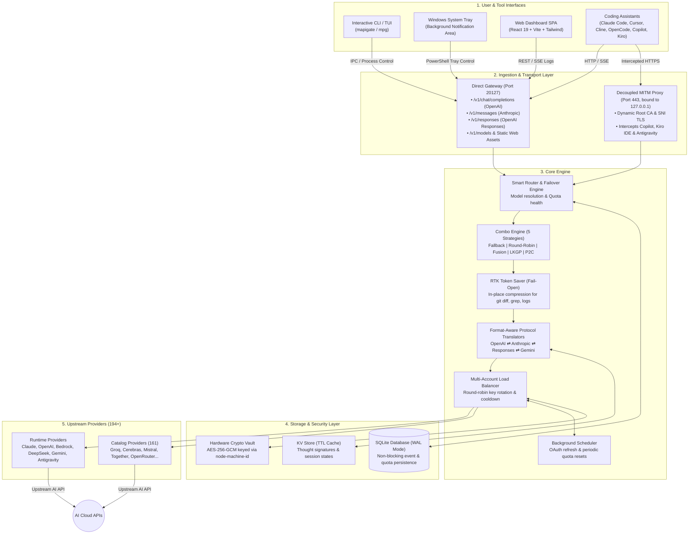
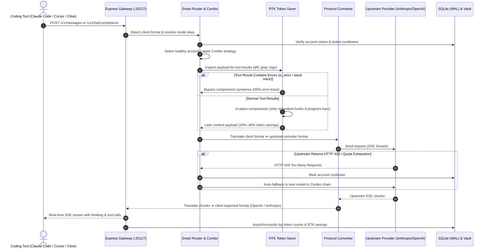
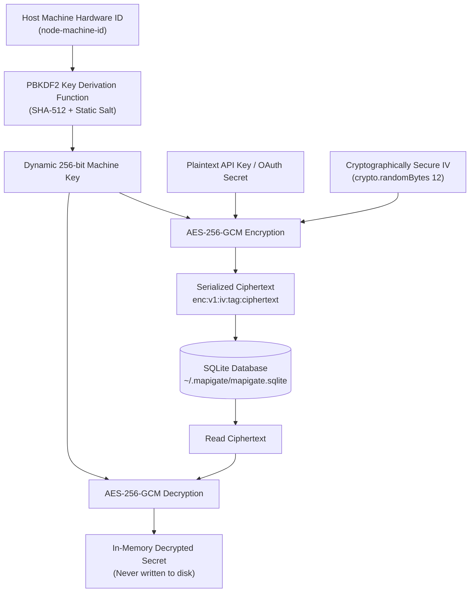
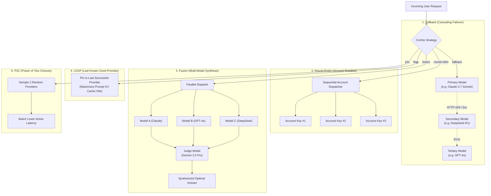

# System Architecture & Technical Specifications — Mapigate

> **Positioning:** Ultra-lightweight, 100% local-first AI Model API Gateway and Token Optimizer engineered exclusively for **AI Coding Assistants** (Claude Code, Cursor, Cline, OpenCode, Codex, GitHub Copilot, Kiro IDE, and Continue).  
> **Core Tenet:** Zero telemetry, single unified port (`20127`), fail-open token compression, hardware-salted AES-256-GCM encryption vault, and pluggable zero-manual-import registry architecture.

---

## 1. High-Level Architecture

Mapigate unifies the fragmented ecosystem of AI coding assistants and upstream model providers into a high-performance local routing plane.



---

## 2. Request Lifecycle & Pipeline

Every incoming request passes through an optimized, non-blocking pipeline:



---

## 3. Hardware-Salted Security Architecture

Mapigate ensures credentials and API keys are never stored in plain text:



---

## 4. Combo Routing Engine Strategies

Mapigate supports 5 distinct model coordination strategies in `src/providers/composite/combo/`:



---

## 5. Directory Structure & Responsibilities

```
mapigate/
├── bin/
│   └── mapigate.js              # Executable CLI entry point (mapigate & mpg aliases)
├── scripts/
│   ├── generate-registries.mjs  # Pure pre-build scanner generating all module registries
│   ├── generate-icons.mjs       # Generates optimized provider icon assets
│   └── publish-local.mjs        # Local npm pack and install test helper
├── src/
│   ├── cli/                     # CLI commands, daemon manager, TUI, Windows tray
│   │   ├── commands/            # start, stop, restart, status, logs, connect, show, doctor...
│   │   ├── daemon/              # Background process lifecycle, PID file, autostart
│   │   ├── tools/               # Modularized CLI tool definitions (26 tools)
│   │   ├── tray/                # Windows PowerShell notification tray integration
│   │   └── tui/                 # Terminal interactive launcher
│   ├── core/                    # Pure framework-agnostic Gateway Engine
│   │   ├── adapters/            # Protocol converters (OpenAI ⇄ Anthropic ⇄ Responses ⇄ Gemini)
│   │   ├── capabilities/        # Context window & thinking token resolution engine
│   │   ├── router/              # Routing rules, fallback chains, combo presets, load balancing
│   │   ├── tokenSaver/          # Token Saver architecture (RTK, Caveman, Ponytail, CustomPrompt)
│   │   └── scheduler/           # Periodic quota resets and OAuth token refreshers
│   ├── providers/               # Hierarchical Provider Modules (194+ providers)
│   │   ├── runtime/             # Custom providers (claude, openai, bedrock, copilot, antigravity...)
│   │   ├── composite/           # Multi-model composite providers (combo engine)
│   │   └── catalog/             # Lightweight standard providers (161 API-key providers)
│   ├── mitm/                    # Decoupled HTTPS Interceptor (port 443, MAPIGATE_MITM_PORT)
│   ├── server/                  # HTTP & SSE Express Gateway (Port 20127)
│   ├── storage/                 # SQLite (WAL mode) & AES-256-GCM hardware crypto vault
│   ├── web/                     # Web Dashboard SPA (React 19 + Vite + Tailwind CSS)
│   └── shared/                  # Common TypeScript interfaces, enums, constants
├── docs/                        # Complete technical documentation suite
└── tests/                       # Automated test suite (102 test files)
```

---

## Management API

The dashboard and CLI talk to the gateway through a REST API under `/api/*`. When a Master Password is set, every `/api/*` route except `/api/auth` requires a session token. Routes below come from `src/server/routes/`.

| Prefix | Purpose | Key routes |
| :--- | :--- | :--- |
| `/api/auth` | Master Password | `GET /status`, `POST /setup`, `POST /login`, `POST /logout`, `PUT /change-password`, `DELETE /remove-password` |
| `/api/providers` | Providers & accounts | `GET /`, `POST /`, `GET /:id`, `DELETE /:id`, `GET /registry`, `POST /:id/accounts`, `POST /:id/accounts/bulk`, `PUT /:id/accounts/reorder`, `PUT /:id/strategy`, `POST /:id/test`, `POST /test-bulk`, `POST /:id/scan-models`, `GET /community-catalog`, `POST /community-catalog/import` |
| `/api/oauth` | OAuth flows (generic + provider `routes.ts`) | `GET /:provider/authorize`, `GET /:provider/device-code`, `POST /:provider/poll`, `POST /:provider/exchange` |
| `/api/models` | Model list & alias rules | `GET /`, `GET /available`, `POST /rules`, `DELETE /rules/:id` |
| `/api/combos` | Combo engine | `GET /`, `POST /`, `GET /:id`, `PUT /:id`, `POST /:id/toggle`, `DELETE /:id`, `GET /presets`, `POST /presets` |
| `/api/cli-tools` (also `/api/tools`, `/api/model-mappings`) | Tool status, apply/reset, model mappings | `GET /status`, `POST /:tool/apply`, `POST /:tool/reset`, `GET\|POST /global-mappings`, `POST /global-mappings/import/:tool`, `GET\|POST /:tool/mappings` |
| `/api/mitm` | MITM proxy | `GET /status`, `POST /toggle-server`, `POST /toggle-dns`, `GET /cert`, `POST /install-cert`, `POST /uninstall-cert`, `GET /port-status`, `GET\|POST /hosts/:tool`, `GET\|POST /mappings/:ide` |
| `/api/quota` | Per-account quota | `GET /`, `GET /:accountId`, `POST /batch-refresh`, `PUT /accounts/:accountId` |
| `/api/usage` | Usage analytics | `GET /stats`, `GET /chart`, `GET /providers`, `GET /request-details`, `GET /request-details/:id`, `GET /stream` (SSE) |
| `/api/stats` | Summary stats | `GET /`, `GET /logs` |
| `/api/console-logs` | Server log viewer | `GET /`, `DELETE /`, `GET /stream` (SSE), `GET\|PUT /level` |
| `/api/settings` | Settings | `GET\|PUT /`, `GET\|PUT /endpoint`, `GET\|POST /endpoint/keys`, `GET\|PUT /token-saver`, `GET\|PUT /capacity-adapter`, `GET\|PUT /logging`, `GET\|POST /autostart`, `GET /system-info` |
| `/api/server` | Lifecycle | `POST /shutdown`, `POST /restart` |
