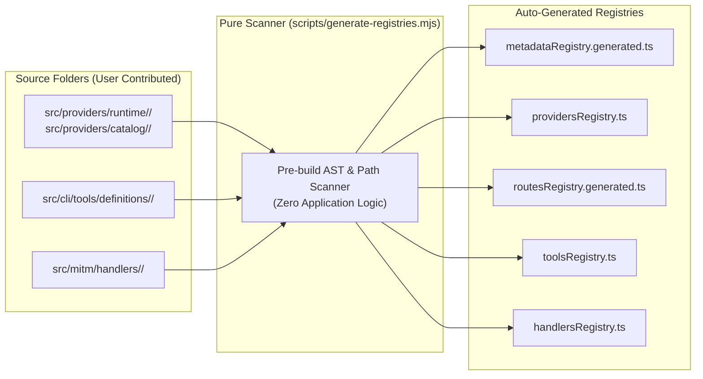

# Developer Guide & Contribution Specifications — Mapigate

> This technical guide is intended for developers who wish to explore the Mapigate codebase, build from source, contribute new features, or integrate additional AI providers, CLI tools, or MITM handlers.  
> If you are an end user looking for product features and usage instructions, please consult [README.md](../README.md).

---

## 1. Prerequisites & Environment Setup

- **Node.js:** `>= 22.5.0` (Node.js 22 LTS recommended for native `node:sqlite` WAL mode support).
- **Supported OS:** Windows (PowerShell) and Linux/macOS. Shell scripts (`.sh`) are prohibited; all tooling is cross-platform Node.js (`.mjs` / `.ts`).
- **Package Manager:** `npm`, `pnpm`, or `yarn`.

```bash
# 1. Clone the repository
git clone https://github.com/joutvhu/mapigate.git
cd mapigate

# 2. Install all dependencies
npm install

# 3. Launch live development environment (Server + Web HMR simultaneously)
npm run dev
```

`npm run dev` concurrently boots:
- **Server:** `tsx watch src/server/index.ts` (with hot reloading on server source edits).
- **Web Dashboard:** Vite dev server on `http://localhost:5173` with instant Hot Module Replacement (HMR).

---

## 2. Scripts & Build Pipeline

| Command | Purpose |
| :--- | :--- |
| `npm run codegen` | Scans module directories and regenerates typed registries (`scripts/generate-registries.mjs`) |
| `npm run build` | Cleans `dist/`, compiles server TypeScript to `dist/server`, and builds Vite SPA to `dist/web` |
| `npm run typecheck`| Validates TypeScript type safety across the entire codebase (`tsc --noEmit`) |
| `npm test` | Runs the automated test suite (102 test files, ~760 tests, Node.js native test runner via `tsx`) |
| `npm run clean` | Removes the compiled `dist/` directory |
| `npm run cli` | Runs the CLI directly via `tsx src/cli/index.ts` without needing a compilation step |
| `npm run build:icons` | Regenerates icon assets and favicon variants (`scripts/generate-icons.mjs`) |
| `npm run local:pack` | Validates build and packages a local tarball artifact |
| `npm run local:publish` | Installs and tests the package locally in the global environment |
| `npm link` | Creates a global symlink so `mpg` and `mapigate` can be invoked from any directory |

---

## 3. Pluggable Architecture: The Pure Scanner Invariant

Mapigate strictly enforces the **Open-Closed Principle (OCP)**:
- Developers **never** manually edit import lists, central routing switch-cases, or static provider arrays.
- `scripts/generate-registries.mjs` acts as an automated, pure file-system scanner. It scans modules (currently discovering **194 providers**, **21 provider routes**, **3 MITM handlers**, and **26 CLI tools**) and generates typed registries in `generated/`.



---

## 4. Extending Mapigate

### 4.1. Adding a New AI Provider

#### Scenario A: Standard OpenAI or Anthropic API-Key Compatible Provider
1. Create directory: `src/providers/catalog/<provider-id>/`.
2. Add `metadata.ts`:
   ```typescript
   import type { ProviderRegistryItem } from "../../core/types.js";

   export const metadata: ProviderRegistryItem = {
     id: "my-provider",
     name: "My Provider",
     type: "openai", // or "anthropic"
     baseUrl: "https://api.myprovider.com/v1",
     color: "#3B82F6",
     models: [
       { id: "my-model-v1", name: "My Model V1", contextWindow: 128000 }
     ]
   };
   ```
3. Add `provider.ts` extending `OpenAiCompatibleProvider`:
   ```typescript
   import { OpenAiCompatibleProvider } from "../../core/base/openAiCompatible.js";
   import { metadata } from "./metadata.js";

   export class MyProvider extends OpenAiCompatibleProvider {
     constructor() {
       super(metadata);
     }
   }
   ```
4. Place an icon in `assets/icon.png` (or `icon.svg`).
5. Run `npm run codegen` — the provider is instantly available in the Web Dashboard and CLI.

#### Scenario B: Custom Auth, SigV4, or Binary Streaming (Runtime Provider)
1. Create directory: `src/providers/runtime/<provider-id>/`.
2. Implement isolated modules: `metadata.ts`, `provider.ts`, `auth.ts`, and optionally `routes.ts` (for custom OAuth PKCE or device authorization flows).
3. Export custom routes via:
   ```typescript
   import { Router } from "express";
   export function registerRoutes(router: Router): void {
     router.post("/auth/login", handleLogin);
   }
   ```
4. Run `npm run codegen` and verify with `npm run typecheck`.

---

### 4.2. Adding a New Coding Assistant (`mpg connect`)

1. Create directory: `src/cli/tools/definitions/<tool-id>/`.
2. Add `definition.ts` specifying metadata and default configurations:
   ```typescript
   import type { CliToolDefinition } from "../../types.js";

   export const definition: CliToolDefinition = {
     id: "mytool",
     name: "My Tool",
     homepage: "https://mytool.ai",
     description: "AI Coding Assistant",
     configPaths: ["~/.mytool/config.json"],
     envVars: [
       { name: "MYTOOL_BASE_URL", value: "{baseUrl}/v1" },
       { name: "MYTOOL_API_KEY", value: "{apiKey}" }
     ],
     defaultModels: [
       { alias: "default", defaultValue: "claude-sonnet-4-6" }
     ]
   };
   ```
3. (Optional) Add `configurator.ts` implementing `apply()` and `reset()` if the tool supports automatic configuration file modifications.
4. Run `npm run codegen`. You can immediately test the new integration:
   ```bash
   npm run cli -- connect mytool
   ```

---

### 4.3. Adding a New MITM Interceptor Handler

To intercept traffic from a tool that hardcodes endpoints:
1. Create directory: `src/mitm/handlers/<tool-id>/`.
2. Add `config.ts`: Define intercepted hosts (e.g. `api.tool.com`), URL path regexes, and model synonyms.
3. Add `handler.ts` implementing `IMitmHandler`: decode requests, map models, and forward to upstream providers.
4. Run `npm run codegen`.

---

## 5. Architectural Invariants for Contributors

When writing code for Mapigate, adhere to these development rules:

1. **File Size Discipline:** Source files must remain under 200–300 lines. Decompose large components into modular helpers.
2. **Fail-Open Invariant:** All parsing logic in RTK and proxy handlers must be wrapped in defensive `try...catch` blocks and return original payloads if an anomaly occurs. Never abort a user's coding turn.
3. **API Key Security Invariant:** Credentials saved to SQLite must be encrypted via `cryptoVault.encrypt()` using the Machine ID key. Plaintext keys must never be logged.
4. **Cross-Platform Compatibility:** Never introduce `.sh` shell scripts. Always use `node:path` methods (`path.join`, `path.resolve`) for filesystem operations.
5. **UI Icon Consistency:** Render provider, tool, and MITM icons through `src/web/src/components/ui/ToolIcon.tsx` with proper `iconBg` support for dark surfaces.

---

## 6. Automated CI/CD & GitHub Actions Workflows

Mapigate enforces quality and automated releases through GitHub Actions:

### 6.1. Continuous Integration (`.github/workflows/ci.yml`)
Runs automatically on every push and pull request to the `main` branch across both **Ubuntu** and **Windows** operating systems:
- Sets up Node.js 22 LTS environment.
- Installs dependencies via `npm ci`.
- Runs static typechecking (`npm run typecheck`).
- Builds production server and Vite dashboard bundles (`npm run build`).
- Executes the full automated test suite (`npm test`).

### 6.2. Automated npm Release (`.github/workflows/release.yml`)
Triggered when a GitHub Release is published:
- Sets up Node.js 22 with the npm registry endpoint.
- Runs `npm ci`, `npm run check`, and `npm run build`.
- Publishes to npm with public access using the `NPM_TOKEN` secret.

