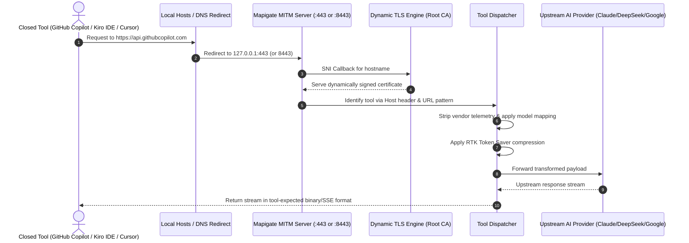

# MITM HTTPS Interceptor Guide — Mapigate

> **Why MITM?** Most modern coding assistants support custom Base URLs (`ANTHROPIC_BASE_URL` or OpenAI Base URL override). However, certain tools—such as **GitHub Copilot**, **legacy Cursor binaries**, or **Kiro IDE**—hardcode upstream endpoints.  
> Mapigate's decoupled **MITM Interceptor** solves this by running a local HTTPS proxy that intercepts these requests, applies model mappings, and routes them to your desired AI providers with full RTK compression.

---

## 1. Architecture & Port Binding

- **Default Primary Port:** `443` (requires Administrator on Windows or root on Linux if binding to standard HTTPS port) or `8443` for user-space proxying.
- **TLS Engine:** Uses `node-forge` to generate a self-signed Root CA and issues on-the-fly leaf certificates for intercepted hostnames using TLS SNI callbacks.

---

## 2. Setting Up the MITM Proxy

### Step 1: Open MITM Tab in Web Dashboard
Navigate to `http://127.0.0.1:20127` and click the **MITM** tab.

### Step 2: Install Root Certificate Authority (CA)
Click **Install Root CA**:
- **Windows:** Mapigate installs the certificate into the `LocalMachine\Root` certificate store using PowerShell (`certutil` / `Import-Certificate`). A UAC prompt may appear for administrator authorization.
- **macOS / Linux:** Mapigate adds the certificate to the system keychain or trust store.

### Step 3: Enable Interception for Your Tool
Select the tool you wish to intercept:
- **GitHub Copilot:** Redirects `api.githubcopilot.com` to Mapigate.
- **Cursor IDE:** Redirects `api.cursor.sh` to Mapigate.
- **Kiro IDE:** Intercepts Kiro's internal streaming protocol.

Mapigate automatically adds the required entries to your system `hosts` file (`C:\Windows\System32\drivers\etc\hosts` on Windows, `/etc/hosts` on Linux/macOS).

---

## 3. Specialized Tool Handlers

### 3.1. GitHub Copilot Handler
- Intercepts requests to `https://api.githubcopilot.com/chat/completions`.
- Strips Copilot-specific proprietary telemetry and headers.
- Translates chat payload into standard OpenAI or Anthropic format.
- Resolves model mapping (e.g., mapping `gpt-4o` to `deepseek-chat` or `claude-sonnet-4-6`).

### 3.2. Kiro IDE & Antigravity Trajectory Handler
- Intercepts Kiro IDE's communication with AWS Bedrock / Google Cloud Code endpoints.
- **Trajectory Preservation:** Tracks turn sequences and session IDs (`toNumericSessionId`), activating Google Cloud Code Prompt KV caching for **~98% cache hit rate**, dropping turn latency from 12s to under 2s.
- **Thought Signature Persistence:** Safely persists cryptographic reasoning thought signatures in SQLite (`kv_store` with 7-day TTL) so multi-turn reasoning is never broken.
- **Binary Event Stream Framing:** Translates upstream chunks into Kiro's binary event-stream frames (`toolUseEvent`, `messageStopEvent`, `usageEvent`).
- **Alphabetical Model Sorting:** Models presented to Kiro are organized alphabetically with `auto` pinned at the top for consistent model selection.

---

## 4. Security & Port Lifecycle Invariants

### 4.1. Localhost Binding Restriction (`127.0.0.1`)
For maximum security, the MITM interceptor binds strictly to the loopback address (`127.0.0.1`). It never binds to `0.0.0.0`, preventing devices on the same local area network (LAN) from accessing the proxy or intercepted traffic.

### 4.2. Security Headers & Telemetry Stripping
- Outgoing upstream requests have proprietary IDE telemetry headers stripped (e.g. tracking cookies, device tokens, and analytics identifiers).
- Incoming intercepted responses receive security headers, preventing local browser-based exploits or CSRF attempts against the proxy endpoints.

### 4.3. Port Conflict Detection & Daemon Shutdown
- Before starting, the MITM server validates that ports `443` or `8443` are free.
- On Windows, Winsock socket states (such as `TIME_WAIT`) are handled defensively.
- When stopping Mapigate (`mpg stop`), the MITM server closes active client sockets and safely releases port bindings.

### 4.4. Live Status Indicator in Web UI Header
The Mapigate Web Dashboard header features a live status indicator showing whether the MITM proxy is active and healthy, including a visual badge and quick-toggle options.

---

## 5. Disabling and Uninstalling MITM

When you no longer need HTTPS interception:
1. In the **MITM** tab, toggle OFF the active tool interception. Mapigate cleanly removes the DNS entries from your `hosts` file.
2. Click **Uninstall Root CA** to remove the certificate from your system trust store.
3. No lingering background network changes remain.
