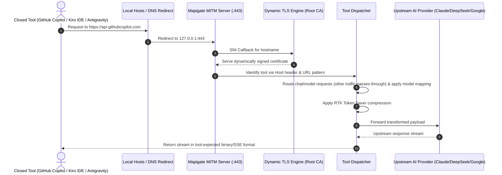

# MITM HTTPS Interceptor Guide — Mapigate

> **Why MITM?** Most modern coding assistants support custom Base URLs (`ANTHROPIC_BASE_URL` or OpenAI Base URL override). However, certain tools, such as **GitHub Copilot**, **Kiro IDE**, and **Antigravity**, hardcode upstream endpoints.  
> Mapigate's decoupled **MITM Interceptor** solves this by running a local HTTPS proxy that intercepts these requests, applies model mappings, and routes them to your desired AI providers with full RTK compression.

---

## 1. Architecture & Port Binding

- **Port:** `443` by default (requires Administrator on Windows or root on Linux). Override with the `MAPIGATE_MITM_PORT` environment variable.
- **Bind address:** `127.0.0.1` by default. Override with `MAPIGATE_MITM_HOST`.
- **TLS Engine:** Uses `node-forge` to generate a self-signed Root CA and issues on-the-fly leaf certificates for intercepted hostnames using TLS SNI callbacks.

---

## 2. Setting Up the MITM Proxy

### Step 1: Open MITM Tab in Web Dashboard
Navigate to `http://127.0.0.1:20127` and click the **MITM** tab.

### Step 2: Install Root Certificate Authority (CA)
Click **Install Root CA**:
- **Windows:** Mapigate installs the certificate into the `LocalMachine\Root` certificate store using PowerShell (`certutil` / `Import-Certificate`). A UAC prompt may appear for administrator authorization.
- **macOS / Linux:** Mapigate adds the certificate to the system keychain or trust store.

### Step 3: Enable Interception for Your Tool
Three handlers ship in `src/mitm/handlers/`:

| Handler | Intercepted hosts |
| :--- | :--- |
| **GitHub Copilot** (`copilot`) | `api.githubcopilot.com`, `api.individual.githubcopilot.com`, `api.business.githubcopilot.com`, `api.enterprise.githubcopilot.com`, `copilot-proxy.githubusercontent.com` |
| **Kiro IDE** (`kiro`) | `management.us-east-1.kiro.dev`, `runtime.us-east-1.kiro.dev`, `q.us-east-1.amazonaws.com`, `codewhisperer.us-east-1.amazonaws.com` |
| **Antigravity** (`antigravity`) | `cloudcode-pa.googleapis.com`, `daily-cloudcode-pa.googleapis.com` |

Hosts per tool can be edited or reset from the MITM tab (`/api/mitm/hosts/:tool`).

Mapigate automatically adds the required entries to your system `hosts` file (`C:\Windows\System32\drivers\etc\hosts` on Windows, `/etc/hosts` on Linux/macOS).

---

## 3. Specialized Tool Handlers

### 3.1. GitHub Copilot Handler
- Intercepts requests to `https://api.githubcopilot.com/chat/completions`.
- Non-chat traffic (auth, telemetry, experiments) passes through to GitHub unchanged.
- Translates chat payload into standard OpenAI or Anthropic format.
- Resolves model mapping (e.g., mapping `gpt-4o` to `deepseek-chat` or `claude-sonnet-4-6`).

### 3.2. Kiro IDE & Antigravity Trajectory Handler
- Intercepts Kiro IDE's communication with AWS Bedrock / Google Cloud Code endpoints.
- **Trajectory Preservation:** Tracks turn sequences and session IDs (`toNumericSessionId`), activating Google Cloud Code Prompt KV caching for **~98% cache hit rate**, dropping turn latency from 12s to under 2s.
- **Thought Signature Persistence:** Safely persists cryptographic reasoning thought signatures in SQLite (`kv_store` with 7-day TTL) so multi-turn reasoning is never broken.
- **Binary Event Stream Framing:** Translates upstream chunks into Kiro's binary event-stream frames (`toolUseEvent`, `messageStopEvent`, `usageEvent`).
- **Alphabetical Model Sorting:** Models presented to Kiro are organized alphabetically with `auto` pinned at the top for consistent model selection.

---

## 4. Security & Port Lifecycle Invariants

### 4.1. Loopback Binding
The MITM server binds to `127.0.0.1` by default (`MAPIGATE_MITM_HOST`), so other machines on the LAN cannot reach it. Only change this if you deliberately want to expose it.

### 4.2. Security Headers
The gateway adds `X-Frame-Options` and `X-Content-Type-Options` to its responses to block clickjacking and MIME sniffing against the dashboard.

### 4.3. Port Conflict Detection & Shutdown
- Before starting, Mapigate checks whether port 443 is in use and reports the owning process (for example IIS, with a hint to run `iisreset /stop`).
- On Windows, a port in `TIME_WAIT` is reported as transient with a Retry option instead of a hard failure.
- Orphaned `hosts` entries left behind while the proxy is stopped are detected and can be cleaned up.
- `mpg stop` releases the MITM port and removes the `hosts` entries.

### 4.4. Status Indicator in the Dashboard Header
The dashboard header shows whether the MITM proxy is running.

---

## 5. Disabling and Uninstalling MITM

When you no longer need HTTPS interception:
1. In the **MITM** tab, toggle OFF the active tool interception. Mapigate cleanly removes the DNS entries from your `hosts` file.
2. Click **Uninstall Root CA** to remove the certificate from your system trust store.
3. No lingering background network changes remain.
