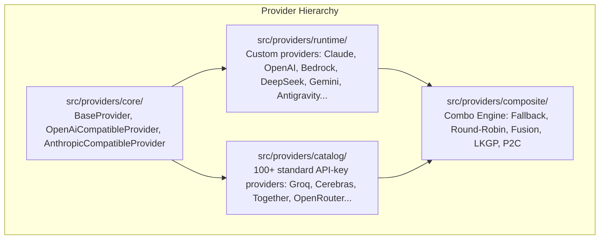

# Providers, Models & Routing Architecture — Mapigate

> Mapigate integrates over **194 AI model providers** into a unified routing plane with multi-account rotation, dynamic fallback, and model combo strategies.

---

## 1. Provider Hierarchy

Mapigate organizes providers into a clean three-tier architecture under `src/providers/`:



### 1.1. Runtime Providers (`src/providers/runtime/`)
Runtime providers feature specialized authentication routines, custom SDK integrations, or OAuth lifecycle refreshers:

| Provider | Key Capabilities |
| :--- | :--- |
| **`claude`** | Anthropic native Messages API, prompt caching headers, thinking tokens (`budget_tokens`). |
| **`openai`** | OpenAI Chat Completions & Responses API (`/v1/responses`), reasoning effort (`low`, `medium`, `high`). |
| **`bedrock`** | AWS SigV4 signed requests, AWS Bedrock Converse stream, Claude 3.7 Sonnet hybrid reasoning. |
| **`github` (Copilot)** | Device code OAuth flow, token refresh scheduler, dynamic session exchange. |
| **`antigravity`** | Google Cloud Code PA endpoint, trajectory protocol, KV prompt caching (~98% hit rate), cryptographic thought signatures. |
| **`deepseek`** | Native DeepSeek-V3 and DeepSeek-R1 reasoning format with tool calling. |
| **`gemini`** | Google AI Studio & Gemini CLI OAuth, thinking level tuning, multi-part function calling. |
| **`ollama`** | Local self-hosted inference, auto-discovery of locally installed models. |
| **`azure`** | Azure OpenAI deployments, custom API versions, managed identities. |
| **`cloudflare`** | Cloudflare Workers AI inference gateway. |

### 1.2. Catalog Providers (`src/providers/catalog/`)
Over 100 lightweight, standard API-key providers configured via isomorphic metadata:
- **Groq, Cerebras, Sambanova, Fireworks, Together AI, DeepInfra, Nebius, Novita, Chutes**
- **Mistral, Cohere, AI21, Voyage AI, Baseten, Hyperbolic, Lepton**
- **Qwen, Kimi (Moonshot), MiniMax, GLM, Baichuan, StepFun, Yi**
- **OpenRouter, AgentRouter, OrcaRouter, Vercel AI Gateway**

All catalog providers inherit from `OpenAiCompatibleProvider` or `AnthropicCompatibleProvider`, requiring zero custom glue code.

---

## 2. Dynamic Model Combos & Routing Strategies

Combos group multiple models into a single virtual model alias (e.g. `coding-combo` or `claude-sonnet-4-6`), managed by the **Combo Engine** (`src/providers/composite/combo/`).

### Five Routing Strategies

```mermaid
graph TD
    subgraph S1["1. Fallback Strategy (Cascading Failover)"]
        FB_START["Client Request"] --> FB_P["Primary: Claude 3.7 Sonnet"]
        FB_P -.->|HTTP 429 Rate Limit / 5xx| FB_S["Secondary: DeepSeek-R1"]
        FB_S -.->|Quota Exceeded| FB_T["Tertiary: GPT-4o"]
    end

    subgraph S2["2. Round-Robin Strategy (Account Rotation)"]
        RR_START["Requests Pool"] --> RR_DISP["Round-Robin Balancer"]
        RR_DISP --> RR_1["Account #1 (Free Tier)"]
        RR_DISP --> RR_2["Account #2 (Team Key)"]
        RR_DISP --> RR_3["Account #3 (Backup Key)"]
    end

    subgraph S3["3. Fusion Strategy (Multi-Model Synthesis)"]
        FUS_START["Hard Coding Prompt"] --> FUS_FAN["Concurrent Fan-Out"]
        FUS_FAN --> M_A["Claude 3.7"]
        FUS_FAN --> M_B["GPT-4o"]
        FUS_FAN --> M_C["DeepSeek-R1"]
        M_A & M_B & M_C --> FUS_JUDGE["Judge Model<br/>(Gemini 2.5 Pro)"]
        FUS_JUDGE --> FUS_FINAL["Optimal Synthesized Code"]
    end

    subgraph S4["4. LKGP (Last Known Good Provider)"]
        LKGP_START["Prompt"] --> LKGP_PIN["Pin to Last Successful Model<br/>(Maximizes Prompt KV Cache)"]
    end

    subgraph S5["5. P2C (Power of Two Choices)"]
        P2C_START["Prompt"] --> P2C_SAMPLE["Sample 2 Random Providers"]
        P2C_SAMPLE --> P2C_SELECT["Dispatch to Lower Active Latency"]
    end
```



### 2.1. Strategy: `fallback`
- Attempts execution with the primary model.
- If upstream returns HTTP 429 (rate limit), 500/502/503 (server error), or timeout, Mapigate immediately cascades to the next configured model in the chain.
- Client connection remains open without dropping the SSE stream.

### 2.2. Strategy: `round-robin`
- Sequentially rotates requests across a pool of models or accounts.
- Distributes query volume evenly to stay below rate limit thresholds across free or tier-restricted accounts.

### 2.3. Strategy: `fusion`
- Queries multiple models in parallel.
- Gathers panel outputs, handles stragglers with a configurable grace period (`stragglerGraceMs: 8000`), and passes all candidate responses to a designated **Judge Model** (e.g. `gemini-2.5-pro` or `gpt-4o`) to author a synthesized, best-of-all output.

### 2.4. Strategy: `lkgp` (Last Known Good Provider)
- Optimizes for warm prompt caching.
- Pins requests to the last successful provider to maximize upstream KV cache hits.
- Seamlessly fails over only when an error is encountered.

### 2.5. Strategy: `p2c` (Power of Two Choices)
- Avoids the herd effect in multi-provider setups.
- Selects two random providers from the healthy pool and dispatches to the one with the lowest recorded latency and error rate.

---

## 3. Multi-Account Load Balancing

You can add multiple accounts for the same provider (e.g., three separate Anthropic API keys or multiple Google accounts):
- Each account tracks its own usage, active rate-limit status, and cooldown period.
- When an account hits a rate limit, Mapigate marks it as cooling down (default: 60s) and automatically routes subsequent requests to the remaining healthy accounts.
- Daily or monthly quota resets are managed automatically via the background scheduler.

---

## 4. Model Aliases & Presets

Mapigate provides built-in presets that map client-native model names to your configured providers:

```bash
# List all configured model aliases and combos:
mpg models
```

### Default Claude Code Presets
When Claude Code requests:
- `claude-3-7-sonnet-20250219` or `sonnet` ➔ routes to `claude/claude-sonnet-4-6` or your configured combo.
- `claude-3-5-haiku-20241022` or `haiku` ➔ routes to your high-speed model.
- `claude-3-opus-20240229` or `opus` ➔ routes to thinking-enabled models.

You can customize these aliases in the **Models** tab of the Web Dashboard or via `mpg connect claude --sonnet <model>`.

---

## 5. Custom Default Headers Management

Mapigate provides granular control over the HTTP headers sent to upstream providers, accessible via **Providers** → Click Provider → **HTTP Headers**:

### 5.1. System Defaults & Custom Overrides
- **Registry Defaults:** Each provider comes with pre-configured headers (such as `anthropic-version`, `anthropic-beta`, custom `User-Agent`, or API versioning headers) declared in its `metadata.ts`.
- **Custom Overrides:** Developers can override default values directly from the Web Dashboard without modifying source code.

### 5.2. Disabling or Omitting Default Headers
In certain integration environments (e.g. corporate proxies, custom API gateways, or strict enterprise firewalls), certain upstream default headers must be suppressed:
- Setting a header override value to empty string `""` explicitly **omits** that header from outgoing requests.
- The UI provides **Disable** / **Enable** buttons for instant toggling.

### 5.3. Isolation and Non-Destructive Storage
- Custom headers are saved in the local SQLite database (`providers.customHeaders`).
- When Mapigate starts, it merges runtime database overrides on top of registry defaults without mutating the immutable provider definitions in `src/providers/`.
- Clicking **Reset to Defaults** restores the provider's exact factory headers.

---

## 6. Combo Execution Analytics & Prefix Normalization

### 6.1. Unified Execution Logging
When a request targets a multi-model combo (e.g. `coding-combo` using a `fallback` strategy from Claude to DeepSeek):
- Mapigate records the parent combo invocation as well as the exact sub-provider/sub-model that satisfied the query.
- In the event of a cascading failover (e.g. primary encountered HTTP 429), both the failed attempt and the successful fallback are recorded.

### 6.2. Combo Analytics in the Usage Dashboard
The **Usage** tab includes dedicated analytics for combo performance:
- **Sub-Model Distribution:** Tracks how often secondary or tertiary fallback models were triggered.
- **Latency Breakdown:** Compares response latency across different models within a combo.
- **Failover Frequency:** Alerts developers when a primary account is experiencing frequent rate limits.

### 6.3. Normalized `combo:` Prefix
In model mapping tables, CLI commands, and API requests:
- Target models can be specified with or without the `combo:` prefix (e.g. `combo:fast-code` or `fast-code`).
- Mapigate automatically normalizes the prefix, resolving combos seamlessly while preventing naming collisions with standalone upstream models.

