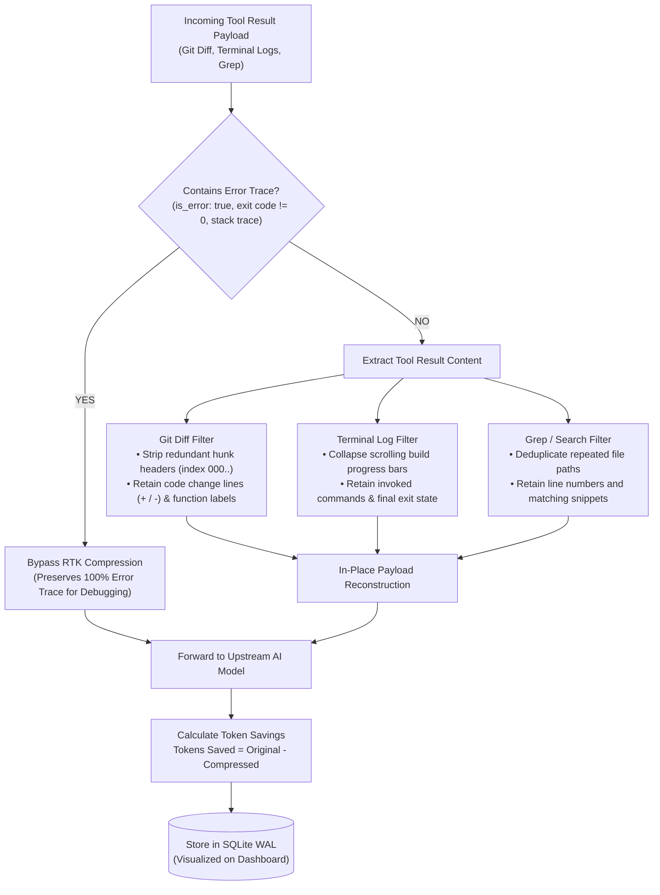
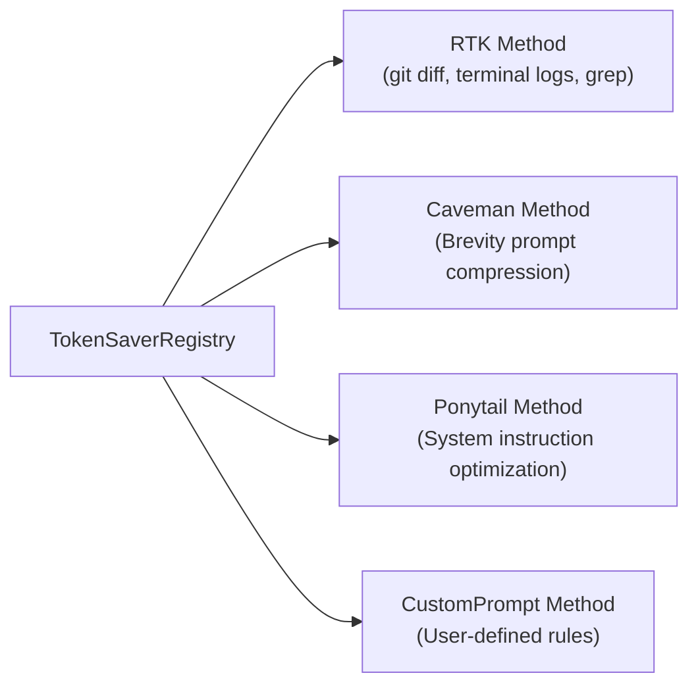

# RTK Token Saver Architecture — Mapigate

> **The Problem:** AI coding assistants (Claude Code, Cursor, Cline, Devin, Roo) consume massive numbers of context tokens through repetitive tool calls (`git diff`, `grep_search`, `read_file`, `execute_pwsh` terminal logs). A single multi-file edit turn can easily inject 15,000–50,000 redundant tokens into the context window.
>
> **The Solution:** Mapigate's **RTK Token Saver** inspects tool payloads and compresses them in-place, achieving **20% to 40% token savings** per session while strictly preserving agent debugging accuracy.

---

## 1. Core Architecture & Pipeline

---

## 2. Core Design Invariants

### 🛡️ Invariant 1: Fail-Open Architecture
The token compressor must **never** break an agent turn.
- Every compression operation is wrapped in defensive `try...catch` blocks.
- If payload parsing fails, if unexpected JSON is encountered, or if compression results in invalid syntax, RTK immediately returns the original payload untouched.

### 🔍 Invariant 2: Error Trace Preservation
When a tool execution encounters an error (e.g. `is_error: true`, compiler errors, stack traces, exit code != 0):
- **RTK completely bypasses compression** for that tool result.
- Coding models need full, unmodified error messages to diagnose bugs and generate fixes. Compressing or truncating error traces leads to hallucinations.

### 📐 Invariant 3: In-Place Context Replacement
- Compression modifies tool output blocks inside the incoming JSON payload before sending it to the upstream model.
- Client session history remains intact; the upstream AI model receives a leaner, higher-density context window.

---

## 3. Compression Methods & Strategies

Mapigate supports four modular token-saving methods registered in `TokenSaverRegistry`:

### 3.1. RTK (Real-Time Tool Compressor)
The primary coding-centric engine:
- **`git diff` Compressor:**
  - Strips redundant hunk headers (`index 0000000..1111111`, unchanged context lines exceeding 3 lines).
  - Preserves exact `+` and `-` modification lines and function/class header labels.
- **Terminal & Build Log Truncator:**
  - Detects verbose build outputs (e.g., `npm install`, `cargo build`, Vite bundling progress bars).
  - Retains the invocation command, warning summaries, failure diagnostics, and exit status.
  - Collapses repetitive progress steps (e.g., `[===>    ] 40%`) into concise summary markers.
- **Search & Grep Compressor:**
  - Deduplicates repeated file paths in large search listings.
  - Limits identical match lines while preserving line numbers and code snippets.

### 3.2. Caveman Method
- Applies concise communication directives to instructions, stripping conversational filler ("Sure, I can help you with that...") from assistant responses.

### 3.3. Ponytail Method
- Inspects system prompt rules and developer guidelines, pruning duplicate steering blocks injected across multi-turn sessions.

### 3.4. Custom Prompt Method
- Allows developers to supply custom prompt compression rules configured in the Web Dashboard.

---

## 4. How Token Savings are Measured

Mapigate calculates token counts before and after compression:

$$\text{Tokens Saved} = \text{Original Tokens} - \text{Compressed Tokens}$$

$$\text{Context Savings \%} = \frac{\text{Tokens Saved}}{\text{Original Tokens}} \times 100\%$$

Each request records:
- Input tokens before RTK
- Input tokens sent to upstream
- Estimated cost saved in USD based on model pricing tiers
- Historical savings are logged into SQLite (`logRepo`) and visualized in the **Token Saver** and **Usage** tabs of the Web Dashboard.

---

## 5. Configuring RTK

In the Web Dashboard at `http://127.0.0.1:20127` → **Token Saver**:
- Toggle RTK compression on or off globally or per-tool.
- Adjust maximum log line limits before truncation.
- View real-time savings counters and cumulative cost reduction graphs.
